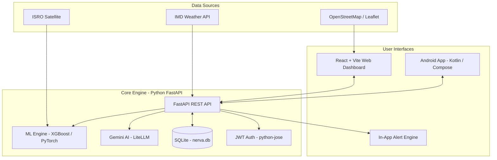
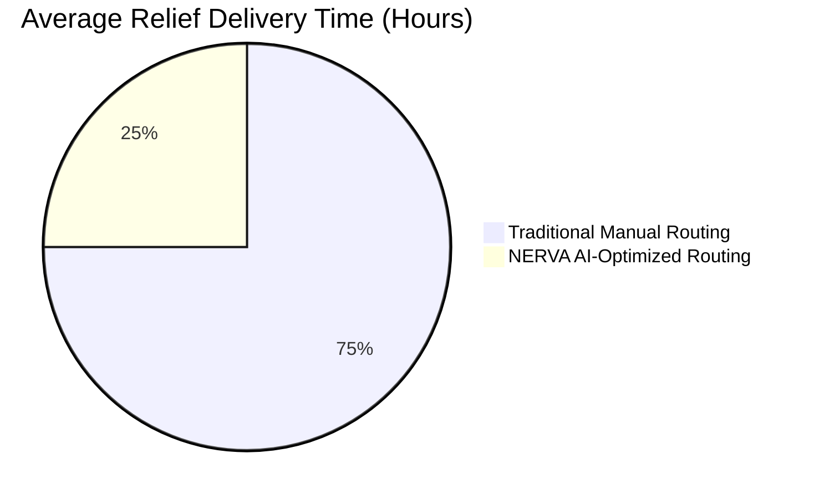
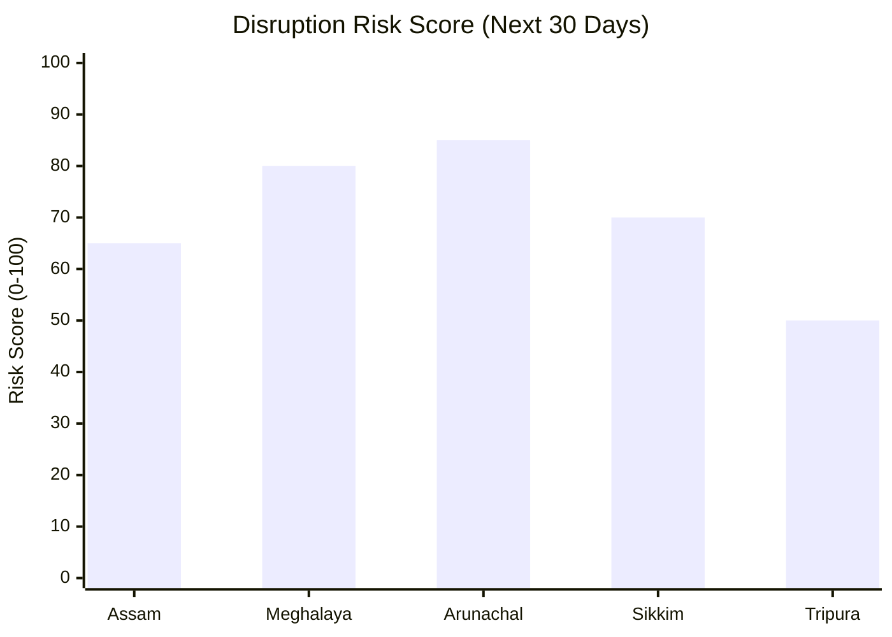

# NERVA: NER Vulnerability & Accessibility Intelligence Platform
> **Smart India Hackathon 2026** | **Problem Statement:** SIH26002

---

## Slide 1: Problem Statement & Context
**Title:** AI-Based Smart Logistics and Accessibility Intelligence Platform for NER 

**The Challenge in NER:**
- **Harsh Terrain & Weather:** Steep hills, extreme monsoons, and seismic activity.
- **Logistics Vulnerability:** Single-point-of-failure highways lead to routine community isolation.
- **Reactive Governance:** Traditional disaster response is slow, manual, and relies on outdated mapping.

**The Need:** 
An AI-driven platform to **predict** disruptions, **optimize** logistics routing, **map** critical accessibility gaps, and **enable** offline field reporting.

---

## Slide 2: The Solution — NERVA
**NERVA** combines predictive analytics, geospatial intelligence, and crowd-sourced reporting to build resilience.

**Key Features:**
1. **Predictive Engine:** AI forecasting for landslides, floods, and road degradation.
2. **GIS Intelligence Dashboard:** Real-time interactive maps of risk zones and accessibility scores.
3. **Smart Route Optimizer:** Dynamic routing factoring terrain, weather, and live blockages.
4. **Field Reporting App:** Offline-first, geo-tagged mobile incident reporting with automated image severity classification.
5. **Early Warning System:** Multilingual disaster alerts (SMS/Push) for at-risk communities.

---

## Slide 3: System Workflow & Architecture

---

## Slide 4: Tech Stack

- **Frontend:** React 19, Vite, React-Leaflet (Maps), Recharts, React Router DOM, PWA
- **Backend:** Python FastAPI, Uvicorn, NetworkX (route optimization)
- **Database:** SQLite (`nerva.db`) — designed for PostGIS migration
- **AI / ML:** XGBoost, PyTorch, Transformers (HuggingFace), Pillow, Gemini API (via LiteLLM)
- **Auth & Security:** JWT (python-jose), Bcrypt (passlib), python-dotenv
- 
---

## Slide 5: Impact & Performance Metrics (Graphs)

**1. Relief Delivery Time Comparison**

**2. Predicted Disruption Risk by Region**

---

## Slide 6: Key Takeaways

- **Proactive vs Reactive:** Shifts logistics and disaster management from a reactive approach to proactive predictive planning.
- **Last-Mile Focus:** Ensures offline capabilities and multilingual support for the most remote areas.
- **Data-Driven:** Leverages high-fidelity satellite, real-time weather, and local crowd-sourced data for ground truth.
- **Scalable:** Cloud-native architecture ready to deploy and scale across all 8 states in the North Eastern Region.
